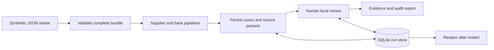

# Local end-to-end accounting system

The operator application joins the existing accounting pipelines into one
persistent local workflow. Its endpoint is an inspectable evidence handoff;
financial execution remains disabled.



## Start and operate

Python 3.11 or newer is required. The application uses the Python standard
library and bundled browser assets; there are no runtime CDN or package-service
requests.

```bash
python3 -m accounting_agent.cli serve --data-dir .local/system --port 8767
```

Open `http://127.0.0.1:8767/`. Choose **Run sample month** or **Import synthetic
JSON**. The sample download provides the accepted bundle format. Processing is
synchronous for a bounded local dataset; the UI shows progress until the saved
run or an error returns. Earlier runs remain available in Work history.

Search cases by counterparty, reference, amount, or case identifier. Filter by
review state or local drafts. Open a case to inspect exact amounts, proposed
matches, risk findings, the source packet, and its evidence hash. A case review
requires a note. Unsaved notes prevent accidental case switching.

The three local outcomes are **reviewed**, **needs changes**, and **rejected**.
Blocked cases cannot be marked reviewed. A local review does not discharge
required accountant roles, approve an invoice, issue a permit, change the
original policy decision, reconcile a bank balance, or execute a financial
operation. Requests for changes stay visible for correction and resubmission
as a new run; source packets are never edited in place.

**Export evidence package** checks the saved evidence and prepares a visible
preview with case, review, and audit counts. Use **Download JSON** to save the
package containing the original bundle, saved run and cases, reviews, audit
records, and a content hash. Failed integrity checks block the export. It is an
accounting evidence handoff, not a posted ledger or tax filing. Export is also
available while review remains incomplete, and includes the actual review
states and policy restrictions.

## Input contract

Download `/api/sample` for a complete example. Its top-level fields are:

| Field | Purpose |
| --- | --- |
| `schema_version` | Bundle schema version, currently `1` |
| `synthetic` | Must be the boolean `true` |
| `name` | Human-readable run name |
| `client_id` / `entity_id` | Fixed local synthetic scopes from the sample |
| `evaluation_date` | Explicit ISO date for deterministic assessment |
| `supplier_invoices` | Synthetic supplier fixture objects |
| `bank_transactions` | Bank rows with explicit currency and signed minor units |
| `open_items` | Open invoice, receipt, or voucher matching targets |

The HTTP request limit is 2 MB. The browser accepts bundle files below 1.8 MB
to leave room for the request envelope. Arbitrary PDFs, real bank exports,
credentials, and real client files are not supported. The synthetic marker is
an explicit input declaration, not an automated privacy classifier.

Invalid bundles produce no partially persisted cases. Failed runs retain their
failure state for inspection. A request key is bound to the exact canonical
input hash: retrying the same key and input returns the existing run, while
reusing a key for different input is rejected.

## Persistence and API

The application stores `local_accounting_system.sqlite` under the selected data
directory. This database is separate from the older fixture queues. It is the
source of truth for runs, cases, review revisions, and audit events. The
existing supplier and bank pipelines still perform accounting checks; the web
application does not implement an alternate accounting engine.

| Endpoint | Behavior |
| --- | --- |
| `GET /api/session` | Obtain the current local request token |
| `GET /api/health` | Check storage readiness; returns 503 when unavailable |
| `GET /api/workspace/backup` | Download a verified ZIP of all saved workspace data |
| `GET /api/sample` | Download a synthetic bundle |
| `GET /api/runs` | List saved runs |
| `POST /api/runs` | Submit `{bundle, request_key}` |
| `GET /api/runs/{run_id}` | Read saved cases and run state |
| `GET /api/runs/{run_id}/cases/{case_id}` | Read full case evidence and review history |
| `POST /api/runs/{run_id}/cases/{case_id}/review` | Save `{outcome, note, expected_revision}` |
| `GET /api/runs/{run_id}/export` | Download the evidence package |

State-changing requests require `Content-Type: application/json` and the
`X-Accounting-Session` header returned by the local session endpoint. The server
checks the loopback Host and same-origin browser requests. Static routes are an
explicit asset list; neither export nor the HTTP server serves arbitrary paths.

Concurrent review changes are protected by an expected revision. A stale save
is rejected instead of overwriting another review. Reload the saved case before
submitting a revised assessment. Both the review and its audit event are saved
in one transaction.

Multi-query reads use one SQLite snapshot, so a concurrent review cannot produce
an export with old case status and new review history. Export validation checks
record hashes, case counts, policy projections, review revisions, evidence
bindings, audit sequences, and run lifecycle events. Inconsistent saved evidence
also blocks new review records.

Workspace backups use SQLite's snapshot API and verify the entire copy before
publication. Restore validates the archive and record relationships before
creating a new directory; it never replaces an existing workspace. See
[release operations](local_release_operations.md) for commands and recovery limits.

Stop with Ctrl-C. Start with the same `--data-dir` to reopen saved work. Keep
this directory outside version control. A different directory starts a separate
local workspace; changing the port does not change saved data.

Processing runs hold an operating-system file lease for their lifetime. The PID
is diagnostic information only. At startup or same-key replay, a processing run
without a held lease becomes interrupted with an audit event; a live owner's
work remains processing. PID reuse does not keep abandoned work alive.
Completion writes retry transient database errors up to three times; exhausted
attempts remain recoverable instead of becoming permanently invalid input.
Interrupted input can be resubmitted with a new request key. The
database has a schema version and required-column checks. The initial compatible
sequenced-audit database is upgraded additively without discarding saved work;
incompatible databases fail clearly before application data is changed.

## Deliberate boundaries

This is a connected local development system. It has no production login,
remote tenant boundary, encrypted client storage, verified reviewer service,
live OCR provider, bank feed, ERP posting, payment, email, or tax connection.
The fixed local-operator review identity is not an authenticated accounting
signoff. Hashes detect checked inconsistencies but do not protect against an
operator replacing the entire local database. Existing authoritative v1
approval/permit primitives remain separate from these local review notes.

The static cockpit remains a reporting surface. Run the new `serve` command
when you need to process input and save review work through the browser.
