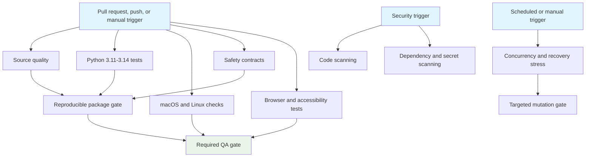

## Workflow Overview

**Purpose**: Prevent unsafe or incomplete Accounting Agent changes from becoming release
candidates by enforcing reproducible, synthetic-only quality gates.

**Trigger Events**: Pull requests, pushes to the primary branch, manual runs, weekly security
analysis, and weekly stress/mutation analysis.

**Target Environments**: GitHub-hosted Linux and macOS runners. Windows is outside the v1
support contract.

The workflows validate release artifacts but never deploy, post accounting data, contact an
ERP, call a hosted model, communicate with a client, initiate a payment, or file a return.

## Execution Flow Diagram



## Jobs & Dependencies

| Job | Purpose | Dependencies | Execution context |
|---|---|---|---|
| Source quality | Compile, lint, type-check, and validate traceability | Repository checkout | Linux |
| Python matrix | Run offline tests and coverage on every supported Python | Repository checkout | Linux, Python 3.11-3.14 |
| Platform matrix | Verify supported OS behavior and system contracts | Repository checkout | Linux and macOS |
| Safety contracts | Exercise permit, approval, evidence, connector, and network-denial boundaries | Repository checkout | Linux |
| Package | Rebuild twice, inspect, and clean-install wheel and source distribution | Source quality, Python matrix, safety contracts | Linux |
| Browser/accessibility | Exercise all supported engines against the loopback synthetic preview | Repository checkout | Linux |
| Required QA gate | Provide one branch-protection result after all release lanes pass | Platform, package, browser/accessibility | Linux |
| Code scanning | Analyze Python source for vulnerabilities | Repository checkout | Linux |
| Dependency/secret scanning | Audit locked dependencies and repository history/content | Repository checkout | Linux |
| Stress | Repeat concurrency, rollback, and crash-recovery tests | Repository checkout | Linux |
| Mutation | Require safety-critical tests to kill targeted mutations | Stress | Linux |

## Requirements Matrix

### Functional Requirements

| ID | Requirement | Priority | Acceptance criteria |
|---|---|---|---|
| REQ-001 | Validate every supported Python runtime | High | Python 3.11, 3.12, 3.13, and 3.14 each complete the offline suite |
| REQ-002 | Validate every supported operating system | High | Linux and macOS each pass the quick system check |
| REQ-003 | Enforce traceability | High | Uncatalogued public API, CLI, or cockpit sections fail CI |
| REQ-004 | Enforce coverage | High | Overall and safety-critical thresholds in the release contract pass |
| REQ-005 | Validate distribution artifacts | High | Dual builds are identical and wheel/sdist pass clean-install checks |
| REQ-006 | Validate browser and accessibility behavior | High | Chromium, Firefox, and WebKit tests complete with no accessibility gate failure |
| REQ-007 | Retain diagnostic evidence | Medium | Sanitized QA, coverage, browser, package, and security reports are downloadable after failures |
| REQ-008 | Exercise failure resilience | High | Scheduled stress tests cover concurrency, locks, integrity, and recovery |
| REQ-009 | Exercise test sensitivity | High | Targeted safety mutations have no surviving unsafe behavior |

### Security Requirements

| ID | Requirement | Implementation constraint |
|---|---|---|
| SEC-001 | Least privilege | Default token permission is read-only; only code scanning may write security events |
| SEC-002 | Immutable dependencies | Every action reference is a full commit SHA with human-readable tag provenance |
| SEC-003 | Untrusted pull requests | Pull-request jobs receive no repository or environment secrets and never use privileged pull-request triggers |
| SEC-004 | External-authority denial | Application tests inherit the socket-denial guard and use synthetic fixtures only |
| SEC-005 | Secret detection | Repository content and history are scanned with redacted output |
| SEC-006 | Supply-chain inspection | Locked dependencies and built artifacts are audited before release eligibility |
| SEC-007 | Credential persistence | Checkout credentials are not persisted in job workspaces |
| SEC-008 | No deployment | No workflow contains deployment credentials, environments, or deployment steps |

### Performance Requirements

| ID | Metric | Target | Measurement |
|---|---|---|---|
| PERF-001 | Pull-request feedback | All required jobs have finite timeouts | Workflow job metadata |
| PERF-002 | Superseded work | Older runs on the same ref are cancelled | Concurrency configuration |
| PERF-003 | Evidence retention | Diagnostic artifacts remain available for 14 days | Artifact metadata |

## Input/Output Contracts

### Inputs

```yaml
repository_revision: immutable commit selected by the trigger
python_versions: [3.11, 3.12, 3.13, 3.14]
platforms: [Linux, macOS]
fixtures: repository-owned synthetic data only
manual_trigger: optional, no privileged parameters
```

### Outputs

```yaml
required_gate: pass or fail
qa_summary: sanitized JSON
test_results: JUnit XML
coverage: JSON, XML, and HTML reports
browser_results: HTML, JUnit, traces, screenshots, and videos on failure
package_results: wheel, source distribution, hashes, and inspection summary
security_results: static, dependency, secret, and code-scanning reports
```

### Secrets & Variables

| Type | Name | Purpose | Scope |
|---|---|---|---|
| Secret | None | Workflows do not consume repository or environment secrets | N/A |
| Ephemeral token | GitHub workflow token | Read checkout metadata and upload permitted results | Per job, least privilege |

## Execution Constraints

### Runtime Constraints

- Every job has a finite timeout.
- Pull-request and push workflows cancel superseded runs on the same ref.
- Matrix jobs do not stop sibling versions after the first failure.
- Diagnostic uploads run after both success and failure and contain no `.local` client data.

### Environmental Constraints

- Only GitHub-hosted Linux and macOS runners are supported.
- Application tests may access only loopback; external application transport is denied.
- Package and dependency installation may access public package registries before guarded tests.
- Browser tests serve the exact synthetic preview on loopback.
- No real documents, credentials, ERP tenants, model endpoints, mailboxes, payments, tax systems,
  or filing systems are configured.

## Error Handling Strategy

| Error type | Response | Recovery |
|---|---|---|
| Source/test failure | Fail affected job; preserve logs and test evidence | Reproduce locally with the same QA command |
| Coverage regression | Fail the Python matrix | Add a red regression test; do not lower the baseline silently |
| Safety-contract failure | Block the required gate | Restore fail-closed behavior and rerun full QA |
| Artifact mismatch | Block packaging | Fix nondeterminism and rebuild twice with the fixed epoch |
| Browser/accessibility failure | Block required gate | Use retained trace/report and rerun the relevant browser project |
| Security finding | Fail scanner or code-scanning gate | Triage; fix or record an approved false positive outside the workflow |
| Scheduled mutation survivor | Fail mutation job | Add a behavior-level regression test or remove equivalent mutation |

## Quality Gates

| Gate | Criteria | Bypass conditions |
|---|---|---|
| Source quality | Compile, lint, type, and traceability checks pass | None |
| Python support | All four supported Python versions pass | None |
| Platform support | Linux and macOS checks pass | None |
| Safety | Selected policy, permit, approval, evidence, connector, and network guards pass | None |
| Coverage | At least 85% lines, 80% branches, and 90% branches in critical modules | None |
| Distribution | Reproducible wheel/sdist, content inspection, and clean-install CLI matrix pass | None |
| UI/accessibility | All supported engines pass the committed Playwright and axe suite | None |
| Security | No unresolved scanner failure, leaked secret, or vulnerable dependency | None |
| Mutation | No unsafe survivor in the configured critical scope | Equivalent/unreachable mutants require reviewed test evidence before configuration changes |

## Monitoring & Observability

- Required job conclusions are visible in GitHub checks.
- Sanitized artifacts are retained for 14 days.
- Scheduled failures remain visible in Actions and repository notifications.
- Concurrency, duration, runner, and revision metadata come from GitHub Actions logs.

## Integration Points

| System | Integration | Data exchange | Constraint |
|---|---|---|---|
| Public package registries | Dependency installation/audit | Locked tool packages and advisory metadata | Never application/client data |
| GitHub code scanning | Static analysis | SARIF and revision metadata | Security-events permission only |
| GitHub artifact storage | Diagnostic evidence | Sanitized QA outputs | 14-day retention; no `.local` accounting data |
| ERP/model/mail/tax/payment systems | None | None | Structurally forbidden |

## Compliance & Governance

- Workflow changes update this specification first and keep configuration tests green.
- Action updates must replace both the immutable SHA and its tag-provenance comment.
- Dependabot proposes weekly updates for actions, Python QA tools, and browser QA tools.
- Human review remains mandatory for workflow permission changes, action provenance, baseline
  changes, exclusions, and mutation configuration.
- Passing CI demonstrates tested software controls; it is not a legal, tax, audit, or regulatory
  compliance opinion.

## Edge Cases & Exceptions

| Scenario | Expected behavior | Validation |
|---|---|---|
| Fork pull request | Runs without repository secrets or writable permissions | Configuration test and GitHub permission model |
| Repeated push | Superseded run is cancelled | Concurrency group behavior |
| Network attempt during application test | Immediate deterministic failure | Socket-denial regression test |
| Missing report after a failure | Upload step still runs and clearly reports missing evidence | Artifact step conditions |
| Windows request | No matrix entry; documented unsupported | Configuration test |
| Scanner needs privileged access | Workflow fails rather than broadening default permissions | Permission review |

## Validation Criteria

- **VLD-001**: Exactly the three specified workflow files and dependency-update policy are present.
- **VLD-002**: Every third-party action uses a 40-character immutable SHA.
- **VLD-003**: Every workflow declares explicit permissions, concurrency, and job timeouts.
- **VLD-004**: Pull requests use the unprivileged pull-request trigger and contain no secret reads.
- **VLD-005**: The Python and platform matrices equal the supported-runtime contract.
- **VLD-006**: QA contains source, safety, package, browser/accessibility, and aggregate gates.
- **VLD-007**: Security includes code, dependency, and secret scanning.
- **VLD-008**: Nightly includes stress and targeted mutation jobs.
- **VLD-009**: No workflow deploys or names an external accounting/model/communication endpoint.

## Change Management

1. Update this specification.
2. Add or change a failing configuration test.
3. Review permissions, action provenance, and data boundaries.
4. Update workflow configuration.
5. Run the focused configuration suite and full release QA.
6. Review a real pull-request run before treating new gates as release evidence.

## Version History

| Version | Date | Change | Author |
|---|---|---|---|
| 1.0 | 2026-07-11 | Initial autonomous QA and hardening specification | Codex |

## Related Specifications

- `qa/traceability.json`
- `docs/accounting_agent_v1.md`
- `playwright.config.ts`
- `pyproject.toml`
